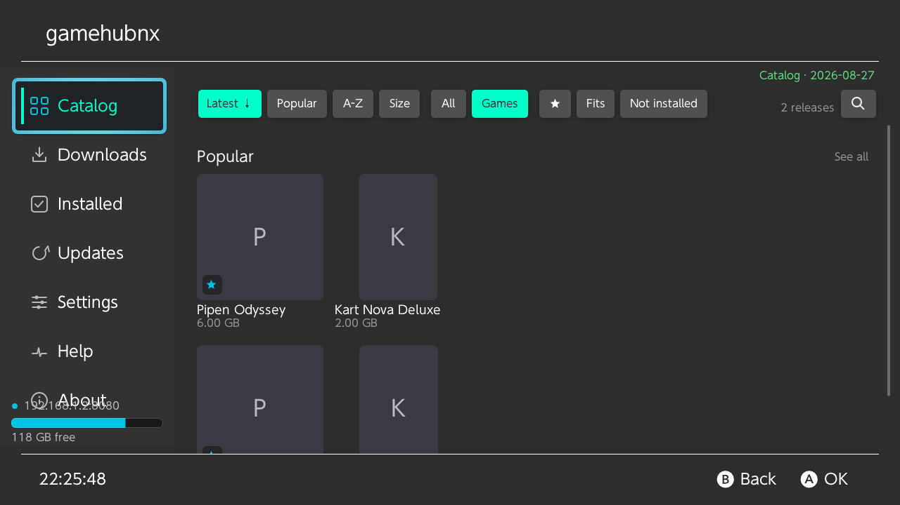
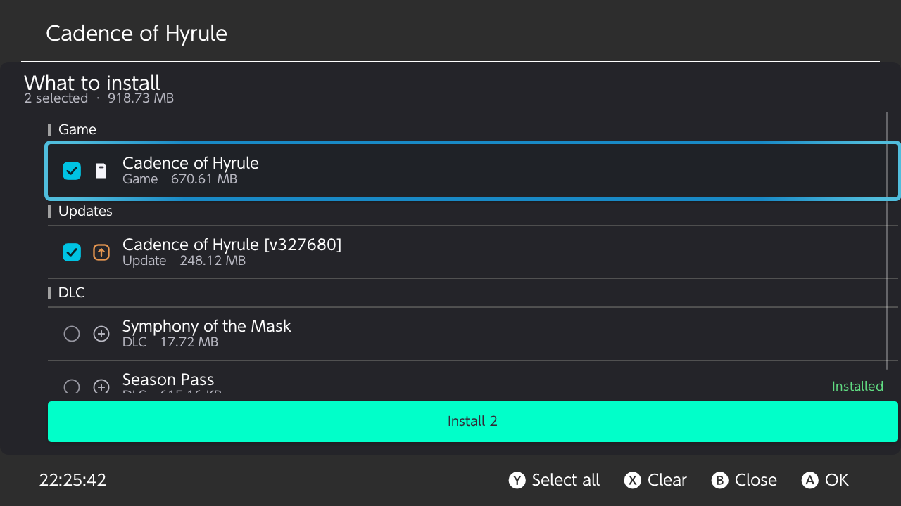
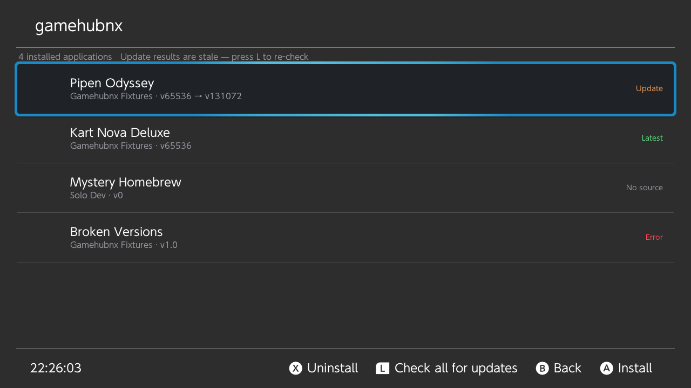
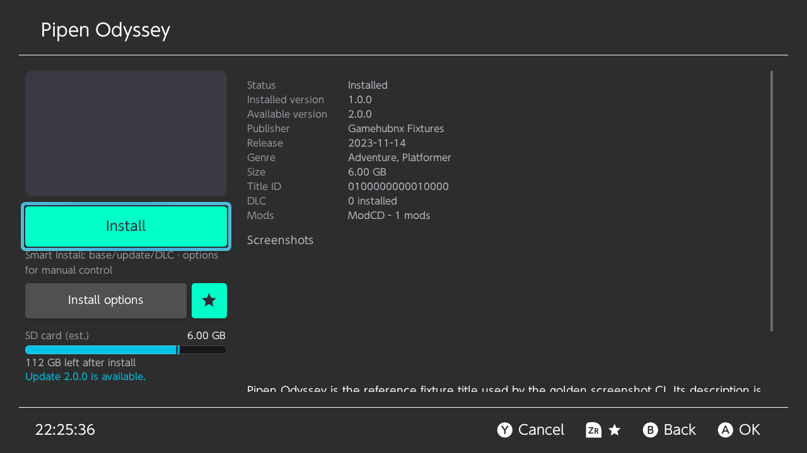

# GameHubNX

[](https://github.com/luishidalgoa/GameHubNX/actions/workflows/ci.yml)
[](https://github.com/luishidalgoa/GameHubNX/actions/workflows/golden.yml)
[](LICENSE)

Nintendo Switch homebrew client for a self-hosted
[GameHub](https://github.com/luishidalgoa/GameHub) library. Browse the catalog
your own server publishes and install games, updates and DLC straight to the
console.

DOWNLOAD LATEST — [gamehubnx.nro](https://github.com/luishidalgoa/GameHubNX/releases/latest/download/gamehubnx.nro)

 
<br><br>
 

> The screenshots above are rendered by the golden-screenshot CI from the
> current build, not captured by hand, so they cannot drift away from what the
> application actually draws.

> [!IMPORTANT]
> GameHubNX does not include Nintendo keys, firmware, games, or a catalog. Use
> it only with content you are legally allowed to download and install. The
> project is not affiliated with Nintendo.

> [!NOTE]
> This project was developed with substantial assistance from AI tools for code
> generation, refactoring, testing, review, and documentation. Changes are
> still built and validated before they are merged.

## What it does

**The store.** Point it at a GameHub instance and its catalog becomes the
Catalog view: cover art, search, sorting, and filters. Updates and DLC arrive
from the server's sub-indexes and are paired with their game by the id the
server publishes, so a dump named any way at all still lands under the right
title. Downloads are plain client/server HTTPS — no account with a third-party
service, no torrent involved.

**Installing.** One screen shows a game together with its updates and its DLC,
grouped and marked with what the console already has, and installs the marked
set in one go. Packages are installed while their bytes arrive rather than
after, and an interrupted install resumes from its last safe point instead of
starting over.

**Where it lands.** Each task carries its own install target, so the memory is
chosen per install rather than once in Settings — and it can still be changed
from Downloads while the task is queued or downloading. What is already on the
console is read from `ncm`, so "installed" means the content is really there,
not merely that the HOME menu still lists it.

**Torrents.** The original BitTorrent path is intact: a queue with pause,
resume, retry and recheck, tracker/DHT/PEX peer discovery, restart-safe piece
verification, and magnet resolution from a verified info dictionary when the
catalog provides one.

**Also inside.** Recognized homebrew-port `switch/` layouts can be previewed and
copied to `SD:/switch/`; a small web companion serves the queue over the local
network; an HTTPS/SOCKS proxy can front catalog and artwork traffic; and the
app updates itself from its own GitHub releases.

The game metadata index ships inside the NRO. Nothing is fetched from a
third-party metadata repository at runtime.

## Quick start

Clone with the pinned submodules — the UI framework is a fork of
[borealis](https://github.com/luishidalgoa/borealis) and the build needs it:

```bash
git clone --recurse-submodules https://github.com/luishidalgoa/GameHubNX.git
cd GameHubNX
```

Run the portable PC test suite:

```bash
make test
```

Build the Nintendo Switch application after installing devkitPro dependencies:

```bash
export DEVKITPRO=/opt/devkitpro
make switch
```

The resulting application is `build-switch/gamehubnx.nro`. See
[BUILD.md](BUILD.md) for dependency installation, golden tests, and deployment
helpers.

## Install on Nintendo Switch

Copy the [NRO](https://github.com/luishidalgoa/GameHubNX/releases/latest/download/gamehubnx.nro) to:

```text
SD:/switch/gamehubnx/gamehubnx.nro
```

Launch it through hbmenu in **application mode** by holding `R` while opening a
game. Album applet mode is rejected because it does not provide enough memory
and network resources for the application.

Runtime data is stored below `SD:/switch/gamehubnx/`:

```text
queue.bencode          downloads/          catalog/catalog.json
torrents/              task-files/         catalog/metadata/
deployments/           dht_nodes.bin       catalog/images/
gamehubnx.log
```

The interface shows contextual controller hints for whatever is focused. The
primary action of a screen is always an on-screen button, never a hint: the
bottom bar has a hard width budget and is checked against it by the golden CI.

## Catalog and network behavior

Two catalog sources coexist. A GameHub instance serves its own library over
HTTPS, including the update and DLC sub-indexes. Independently, the
Langegen [`switch-games`](https://github.com/Langegen/switch-games) source can
be used for torrent entries; Settings accept any other HTTPS URL serving the
same JSON shape. Redirects are limited to the source file's directory and
look-alike hosts are rejected before catalog bytes are parsed. A failed refresh
leaves the last valid SD-card cache active.

One to four downloads may run concurrently, while installation stays
serialized. Existing files are verified before a task starts or resumes.
Packages committed before an interruption remain installed and are skipped on
resume. Sleep/wake, long installs and `/switch` file copying must ultimately be
validated on physical hardware.

## Contributing and security

Read [CONTRIBUTING.md](CONTRIBUTING.md) before sending a change. Report
vulnerabilities privately as described in [SECURITY.md](SECURITY.md); do not
place secrets or copyrighted datasets in issues or fixtures.

Historical implementation notes are archived under
[`docs/plans/`](docs/plans/README.md). They are not the current roadmap.

## License

GameHubNX is licensed under the GNU General Public License v3.0. See
[LICENSE](LICENSE). Third-party components retain their original licenses as
listed in [THIRD_PARTY_NOTICES.md](THIRD_PARTY_NOTICES.md).
